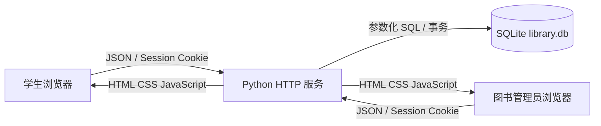

# 系统架构

## 三层职责

1. 展示层：`static/index.html`、`style.css`、`app.js`。学生和管理员共用登录页，登录后按服务端返回的角色渲染各自导航。界面负责表单校验和状态展示，不直接操作数据库。
2. 应用层：`server.py`。负责密码验证、HttpOnly 会话、角色权限、业务校验、借出/归还/预约/续借规则和 JSON API。
3. 数据层：`schema.sql` 和 SQLite。外键保证引用完整性，唯一索引防止同一副本同时存在两条有效借阅，部分唯一索引防止重复有效预约。

## 核心流程

借出：管理员输入学号与条码 → 后端开启 `BEGIN IMMEDIATE` → 检查学生、借阅上限、副本状态与预约优先权 → 写入 loans → 把副本设为 borrowed → 完成该学生对应预约 → 提交。

归还：管理员选择有效借阅 → 后端开启事务 → 写入 returned_at → 副本暂设 available → 若同一书目有等待预约，则把副本设为 reserved，并将最早预约设为 ready → 提交。

学生预约：仅当书目没有 available 副本时允许加入队列。学生只能查看和取消自己的预约；服务端不信任前端传入的学生 ID，而是从会话反查 students。

## 运行边界

应用默认只监听 `127.0.0.1:8000`。SQLite 适合课程演示和单机部署；多人高并发生产环境应迁移到 PostgreSQL 或 MySQL，并用正式 Web 服务器部署。
