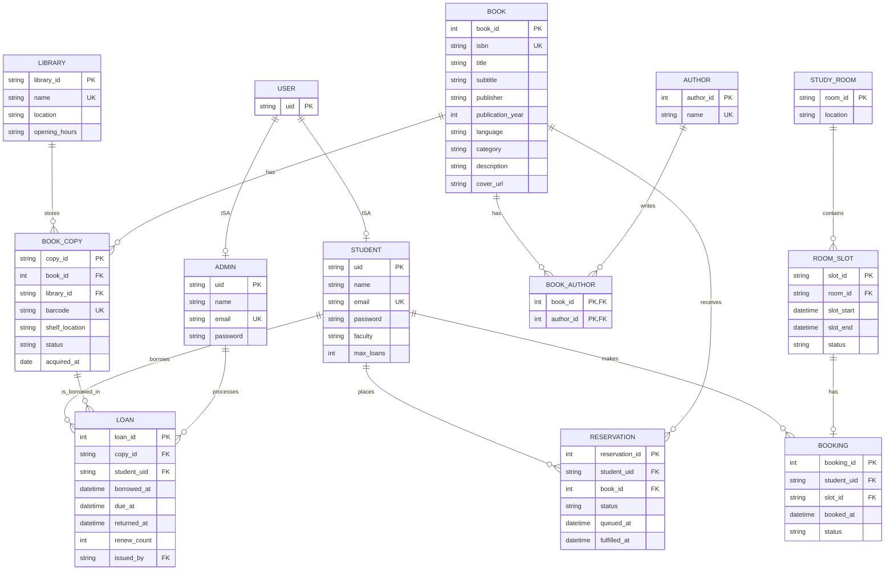

# HKU Library Portal：ER 设计与核心功能说明

## 1. ER 图

`USER` 是抽象父实体，只用于表达 ISA（继承）关系，不单独建立数据库表。学生和管理员分别保存自己的登录信息。



### 关系基数

| 关系 | 基数 | 含义 |
|---|---|---|
| USER–STUDENT | 1 : 0..1 | 一个 User 可以是一个 Student |
| USER–ADMIN | 1 : 0..1 | 一个 User 可以是一个 Admin |
| BOOK–BOOK_COPY | 1 : N | 一本书可以有多个实体副本 |
| BOOK–AUTHOR | M : N | 一本书可以有多个作者，一个作者可以写多本书 |
| LIBRARY–BOOK_COPY | 1 : N | 一个分馆保存多个实体副本 |
| STUDENT–LOAN | 1 : N | 一个学生可以有多条借阅历史 |
| BOOK_COPY–LOAN | 1 : N | 一个实体副本可以有多条历史借阅记录，但同时最多一条未归还记录 |
| STUDENT–RESERVATION | 1 : N | 一个学生可以预约多本书 |
| BOOK–RESERVATION | 1 : N | 一本书可以有多个预约者排队 |
| STUDY_ROOM–ROOM_SLOT | 1 : N | 一个房间拥有多个小时段 |
| STUDENT–BOOKING | 1 : N | 一个学生可以创建多个房间预约 |
| ROOM_SLOT–BOOKING | 1 : 0..1 | 一个时间段最多被一个学生预约 |

## 2. 表和 Attribute 解释

### USER（抽象实体）

USER 不单独建表，只表示 Student 和 Admin 具有相同的身份概念。`uid` 是整个系统中的用户唯一标识。

### STUDENT

| Attribute | 说明 |
|---|---|
| `uid` PK | 学生唯一身份编号，同时也是登录 UID |
| `name` | 学生姓名 |
| `email` UK | 登录邮箱，不能重复 |
| `password` | 登录密码，实际实现应保存哈希值而不是明文 |
| `faculty` | 所属学院 |
| `max_loans` | 同时允许借阅的最大书本数 |

### ADMIN

| Attribute | 说明 |
|---|---|
| `uid` PK | 管理员唯一身份编号 |
| `name` | 管理员姓名 |
| `email` UK | 管理员登录邮箱 |
| `password` | 管理员密码，实际实现应保存哈希值 |

### LIBRARY

| Attribute | 说明 |
|---|---|
| `library_id` PK | 分馆编号 |
| `name` UK | 分馆名称 |
| `location` | 分馆地址 |
| `opening_hours` | 开放时间 |

### BOOK

| Attribute | 说明 |
|---|---|
| `book_id` PK | 书目版本的系统内部编号 |
| `isbn` UK | 书目版本的唯一业务编号；ISBN 不是主键 |
| `title` | 书名 |
| `subtitle` | 副标题 |
| `publisher` | 出版商 |
| `publication_year` | 出版年份 |
| `language` | 语言 |
| `category` | 图书分类 |
| `description` | 图书简介 |
| `cover_url` | 封面地址 |

### AUTHOR

| Attribute | 说明 |
|---|---|
| `author_id` PK | 作者编号 |
| `name` UK | 作者姓名 |

### BOOK_AUTHOR

这是 Book 和 Author 的多对多连接表。`author_order` 已删除。

| Attribute | 说明 |
|---|---|
| `book_id` PK, FK | 对应书目 |
| `author_id` PK, FK | 对应作者 |

### BOOK_COPY

表示真正可以被借走的实体书，而不是抽象书目。

| Attribute | 说明 |
|---|---|
| `copy_id` PK | 实体副本编号 |
| `book_id` FK | 对应哪一本书目 |
| `library_id` FK | 所在分馆 |
| `barcode` UK | 副本条形码 |
| `shelf_location` | 书架位置 |
| `status` | `available`、`borrowed`、`reserved` 或 `maintenance` |
| `acquired_at` | 入馆日期 |

### LOAN

记录学生实际借走的实体副本。

| Attribute | 说明 |
|---|---|
| `loan_id` PK | 借阅记录编号 |
| `copy_id` FK | 借走的实体副本 |
| `student_uid` FK | 借书学生 |
| `borrowed_at` | 借出时间 |
| `due_at` | 应还时间 |
| `returned_at` | 实际归还时间，可为空 |
| `renew_count` | 已续借次数 |
| `issued_by` FK | 办理借出的管理员 UID |

### RESERVATION

预约的是书目 `BOOK`，不是指定的实体副本。学生等待任意一本该书目副本归还。

| Attribute | 说明 |
|---|---|
| `reservation_id` PK | 预约编号 |
| `student_uid` FK | 预约学生 |
| `book_id` FK | 预约书目 |
| `status` | `waiting`、`ready`、`fulfilled` 或 `cancelled` |
| `queued_at` | 加入队列时间 |
| `fulfilled_at` | 预约完成时间 |

### STUDY_ROOM

| Attribute | 说明 |
|---|---|
| `room_id` PK | Study Room 编号 |
| `location` | 房间位置，例如 Level 3 |

### ROOM_SLOT

| Attribute | 说明 |
|---|---|
| `slot_id` PK | 时间段编号 |
| `room_id` FK | 所属房间 |
| `slot_start` | 开始时间 |
| `slot_end` | 结束时间 |
| `status` | `available`、`booked` 或 `expired` |

必须设置：

```sql
UNIQUE(room_id, slot_start)
```

确保一个房间同一小时只有一个 Slot。

### BOOKING

表示学生对某一个 Room Slot 的预约。

| Attribute | 说明 |
|---|---|
| `booking_id` PK | 预约记录编号 |
| `student_uid` FK | 预约学生 |
| `slot_id` FK | 被预约的时间段 |
| `booked_at` | 创建预约的时间 |
| `status` | `confirmed` 或 `cancelled` |

必须设置：

```sql
UNIQUE(slot_id)
```

保证一个时间段不能被两个学生同时预约。每个学生每天最多两个 `confirmed` Booking，需要通过事务检查当天数量。

## 3. Project 核心功能与对应 SQL

## A. 学生借书功能

### A1. 登录

学生使用 Email 和 Password 登录。密码数据库中应保存哈希值。

```sql
SELECT uid, name, email, password_hash
FROM STUDENT
WHERE email = ? AND active = 1;
```

服务端验证密码成功后，用 HttpOnly Cookie 保存登录身份，例如：

```text
library_uid=<signed uid>; role=student
```

### A2. 搜索书目

学生可以按照书名、ISBN 或作者搜索。

```sql
SELECT b.book_id, b.isbn, b.title, b.publisher, b.category,
       GROUP_CONCAT(a.name) AS authors,
       COUNT(bc.copy_id) AS total_copies,
       SUM(CASE WHEN bc.status = 'available' THEN 1 ELSE 0 END) AS available_copies
FROM BOOK b
LEFT JOIN BOOK_AUTHOR ba ON ba.book_id = b.book_id
LEFT JOIN AUTHOR a ON a.author_id = ba.author_id
LEFT JOIN BOOK_COPY bc ON bc.book_id = b.book_id
WHERE b.title LIKE ?
   OR b.isbn LIKE ?
   OR a.name LIKE ?
GROUP BY b.book_id;
```

### A3. 查看一本书的实体副本

```sql
SELECT bc.copy_id, bc.barcode, bc.status,
       bc.shelf_location, l.name AS library_name
FROM BOOK_COPY bc
JOIN LIBRARY l ON l.library_id = bc.library_id
WHERE bc.book_id = ?;
```

### A4. 管理员办理借书

学生实际借的是 `BOOK_COPY`，不是抽象的 `BOOK`。

```sql
BEGIN IMMEDIATE;

-- Lock the write transaction so two librarians cannot borrow the same copy.
SELECT *
FROM BOOK_COPY
WHERE barcode = ?;

-- Check the student's current active-loan count against the loan limit.
SELECT COUNT(*) AS active_loans
FROM LOAN
WHERE student_uid = ? AND returned_at IS NULL;

-- Create the loan record after all validation checks pass.
INSERT INTO LOAN(
    copy_id, student_uid, borrowed_at, due_at, issued_by
)
VALUES (?, ?, ?, ?, ?);

-- Mark the physical copy as borrowed.
UPDATE BOOK_COPY
SET status = 'borrowed'
WHERE copy_id = ?;

-- Commit the loan creation and copy-status update atomically.
COMMIT;
```

借书前要检查：

- 副本状态是 `available` 或属于该学生的 `reserved`
- 学生没有达到 `max_loans`
- 该副本没有被其他学生预约

### A5. 查看我的借阅

```sql
SELECT l.loan_id, l.borrowed_at, l.due_at, l.returned_at,
       b.isbn, b.title, bc.barcode
FROM LOAN l
JOIN BOOK_COPY bc ON bc.copy_id = l.copy_id
JOIN BOOK b ON b.book_id = bc.book_id
WHERE l.student_uid = ?
ORDER BY l.returned_at IS NULL DESC, l.borrowed_at DESC;
```

### A6. 续借

```sql
UPDATE LOAN
SET due_at = ?,
    renew_count = renew_count + 1
WHERE loan_id = ?
  AND student_uid = ?
  AND returned_at IS NULL
  AND renew_count < 2;
```

续借前还需要检查：

- 借阅没有逾期
- 没有其他学生在等待这本书
- 续借次数少于 2 次

### A7. 预约图书

预约对象是 `BOOK`，因为学生等待该书目的任意一本副本。

```sql
SELECT 1
FROM BOOK_COPY
WHERE book_id = ? AND status = 'available';
```

如果没有可用副本：

```sql
INSERT INTO RESERVATION(
    student_uid, book_id, status, queued_at
)
VALUES (?, ?, 'waiting', CURRENT_TIMESTAMP);
```

### A8. 归还后分配给预约队列第一位

```sql
-- Find the first waiting student in queue order.
SELECT reservation_id, student_uid
FROM RESERVATION
WHERE book_id = ? AND status = 'waiting'
ORDER BY queued_at, reservation_id
LIMIT 1;
```

然后：

```sql
-- Hold the returned copy for that student.
UPDATE BOOK_COPY
SET status = 'reserved'
WHERE copy_id = ?;

-- Move the queue entry to the ready-for-pickup state.
UPDATE RESERVATION
SET status = 'ready'
WHERE reservation_id = ?;
```

## B. Study Room 功能

### B1. 查看今天或明天的房间时间段

```sql
SELECT rs.slot_id, rs.room_id, r.location,
       rs.slot_start, rs.slot_end, rs.status
FROM ROOM_SLOT rs
JOIN STUDY_ROOM r ON r.room_id = rs.room_id
WHERE DATE(rs.slot_start) IN (DATE('now'), DATE('now', '+1 day'))
  AND TIME(rs.slot_start) >= '08:00'
  AND TIME(rs.slot_start) < '22:00'
ORDER BY rs.slot_start, rs.room_id;
```

### B2. 预约一个时间段

学生只能预约 `available` 的 Slot。

```sql
BEGIN IMMEDIATE;

-- Confirm that the requested slot is still available.
SELECT status
FROM ROOM_SLOT
WHERE slot_id = ?;

-- Enforce the two-hour-per-day booking limit.
SELECT COUNT(*)
FROM BOOKING b
JOIN ROOM_SLOT rs ON rs.slot_id = b.slot_id
WHERE b.student_uid = ?
  AND b.status = 'confirmed'
  AND DATE(rs.slot_start) = DATE(?);
```

如果当天数量少于 2：

```sql
-- Create the booking record after the validation checks pass.
INSERT INTO BOOKING(
    student_uid, slot_id, booked_at, status
)
VALUES (?, ?, CURRENT_TIMESTAMP, 'confirmed');

-- Mark the slot as booked; the status predicate prevents double booking.
UPDATE ROOM_SLOT
SET status = 'booked'
WHERE slot_id = ? AND status = 'available';

-- Commit the booking and slot update atomically.
COMMIT;
```

### B3. 取消 Study Room 预约

```sql
-- Cancel only the current student's confirmed booking.
UPDATE BOOKING
SET status = 'cancelled'
WHERE booking_id = ?
  AND student_uid = ?
  AND status = 'confirmed';

-- Release the slot so another student can book it.
UPDATE ROOM_SLOT
SET status = 'available'
WHERE slot_id = ?;
```

### B4. 查看 My Bookings

```sql
SELECT b.booking_id, rs.room_id, r.location,
       rs.slot_start, rs.slot_end, b.status
FROM BOOKING b
JOIN ROOM_SLOT rs ON rs.slot_id = b.slot_id
JOIN STUDY_ROOM r ON r.room_id = rs.room_id
WHERE b.student_uid = ?
  AND b.status = 'confirmed'
ORDER BY rs.slot_start;
```

## C. 管理员功能

### C1. 管理员登录

```sql
SELECT uid, name, email, password_hash
FROM ADMIN
WHERE email = ? AND active = 1;
```

成功后使用 HttpOnly Cookie 保存管理员 UID 和角色。

### C2. 查看管理员 Dashboard

```sql
-- Count catalogue titles.
SELECT COUNT(*) FROM BOOK;
-- Count physical copies.
SELECT COUNT(*) FROM BOOK_COPY;
-- Count active loans.
SELECT COUNT(*) FROM LOAN WHERE returned_at IS NULL;
-- Count overdue active loans.
SELECT COUNT(*) FROM LOAN
WHERE returned_at IS NULL AND due_at < CURRENT_TIMESTAMP;
-- Count open book reservations.
SELECT COUNT(*) FROM RESERVATION
WHERE status IN ('waiting', 'ready');
```

### C3. 新增书目

```sql
INSERT INTO BOOK(
    isbn, title, subtitle, publisher,
    publication_year, language, category,
    description, cover_url
)
VALUES (?, ?, ?, ?, ?, ?, ?, ?, ?);
```

然后建立作者关系：

```sql
-- Insert the author once; reuse the existing row if the name already exists.
INSERT INTO AUTHOR(name)
VALUES (?)
ON CONFLICT(name) DO NOTHING;

-- Link the book to the normalized author record.
INSERT INTO BOOK_AUTHOR(book_id, author_id)
VALUES (?, ?);
```

### C4. 修改或删除书目

```sql
UPDATE BOOK
SET title = ?, publisher = ?, category = ?, description = ?
WHERE book_id = ?;
```

删除前需要检查是否存在实体副本、借阅或预约：

```sql
SELECT 1 FROM BOOK_COPY WHERE book_id = ?;
SELECT 1 FROM RESERVATION WHERE book_id = ?;
```

### C5. 管理实体副本

```sql
INSERT INTO BOOK_COPY(
    copy_id, book_id, library_id,
    barcode, shelf_location, status, acquired_at
)
VALUES (?, ?, ?, ?, ?, 'available', ?);
```

管理员也可以修改副本状态：

```sql
UPDATE BOOK_COPY
SET status = ?, shelf_location = ?
WHERE copy_id = ?;
```

### C6. 办理借书

管理员通过学生 UID 和副本 Barcode 办理借书，核心 SQL 与学生借书部分相同，但 `issued_by` 写入管理员 UID。

```sql
INSERT INTO LOAN(
    copy_id, student_uid, borrowed_at, due_at, issued_by
)
VALUES (?, ?, CURRENT_TIMESTAMP, ?, ?);
```

### C7. 办理还书

```sql
-- Keep the return and the next reservation allocation atomic.
BEGIN IMMEDIATE;

-- Close the active loan.
UPDATE LOAN
SET returned_at = CURRENT_TIMESTAMP
WHERE loan_id = ? AND returned_at IS NULL;

-- Make the physical copy available for reuse or allocation.
UPDATE BOOK_COPY
SET status = 'available'
WHERE copy_id = ?;

-- Commit both state changes together.
COMMIT;
```

还书后还需要查询 `RESERVATION` 队列，把副本分配给第一位等待学生。

### C8. 查看学生账户

```sql
SELECT s.uid, s.name, s.email, s.faculty,
       COUNT(l.loan_id) AS active_loans,
       s.max_loans
FROM STUDENT s
LEFT JOIN LOAN l
  ON l.student_uid = s.uid
 AND l.returned_at IS NULL
GROUP BY s.uid
ORDER BY s.uid;
```

### C9. 查看所有图书预约队列

```sql
SELECT r.reservation_id, r.student_uid,
       s.name, r.book_id, b.title,
       r.status, r.queued_at
FROM RESERVATION r
JOIN STUDENT s ON s.uid = r.student_uid
JOIN BOOK b ON b.book_id = r.book_id
ORDER BY r.book_id, r.queued_at;
```

## 4. 关键完整性约束

```sql
UNIQUE(email)
UNIQUE(barcode)
UNIQUE(room_id, slot_start)
UNIQUE(slot_id)
```

此外还需要：

- 一个实体副本同时最多有一条未归还 Loan。
- 一个 Room Slot 同时最多有一条 confirmed Booking。
- 一个学生每天最多两个 confirmed Booking。
- `ROOM_SLOT.status = expired` 的时间段不能预约。
- `LOAN.copy_id` 必须指向真实实体副本。
- `LOAN.issued_by` 必须指向 ADMIN。
- `BOOK_AUTHOR` 使用 `(book_id, author_id)` 作为联合主键。
- 密码必须保存为哈希值，不能保存明文密码。
