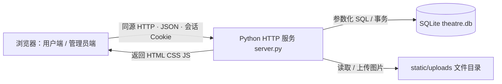

# 系统架构说明（待审版本）

## 三层各自负责什么

1. **展示层**：static/index.html、app.js、style.css。用户看日历、选城市、查开票详情与演员名单；管理员用表单维护剧目、场馆、批次、场次和开票渠道。演员名单用 textarea 提交一整段字符串。城市漏斗使用服务器返回的去重场馆城市列表。
2. **应用层**：server.py 同时提供静态页面和 /api 接口。处理登录、会话、管理员权限、字段格式、图片上传及错误提示。浏览器不能直接执行数据库 SQL；所有修改先经过后端权限检查。城市/演员管理接口已移除，场馆接口接受 city，场次接口接受 cast_text。
3. **数据层**：SQLite 文件存储业务记录、账户及会话，schema.sql 定义表、外键、唯一约束和日期触发器。图片放在文件系统，数据库保存 URL。seed.sql 与 demo_data.py 提供演示数据；migrations.py 负责旧结构备份和事务升级。

## 一次管理员修改如何让用户看到

管理员登录 → 后端检查账号密码及 admin 角色 → 设置 HttpOnly 会话 Cookie → 在“演出场次”编辑演员名单 → PUT /api/admin/performances/{id} → 后端再次校验权限并执行 UPDATE → 事务提交 → 用户刷新详情，GET /api/runs/{id} 查询 performances.cast_text → 页面转义并显示文本。发布权限在 Run.published：用户只能看到已发布批次。

## 日历如何查询

城市列表不是 cities 表，而是 SELECT DISTINCT venues.city。浏览器提交 month=2026-11&city=上海，后端连接 sale_rounds → runs → productions/venues，按开票月份、城市和发布状态筛选。日期上的标记表示开票轮次，不表示当日演出场次数。11/12 月原有模拟批次和场次保留。

## 运行与边界

Python 3.10+，无需 pip/npm 安装；python3 server.py 同时启动前后端，默认 http://127.0.0.1:8000。SQL 表和数据首次启动自动建立。当前为本地课程应用；没有支付、订单、演员独立搜索或生产部署功能。登录角色由数据库决定，前端选择管理员不会直接获得权限。生产部署仍需要 HTTPS、Secure Cookie、登录限速、审计与备份策略。
